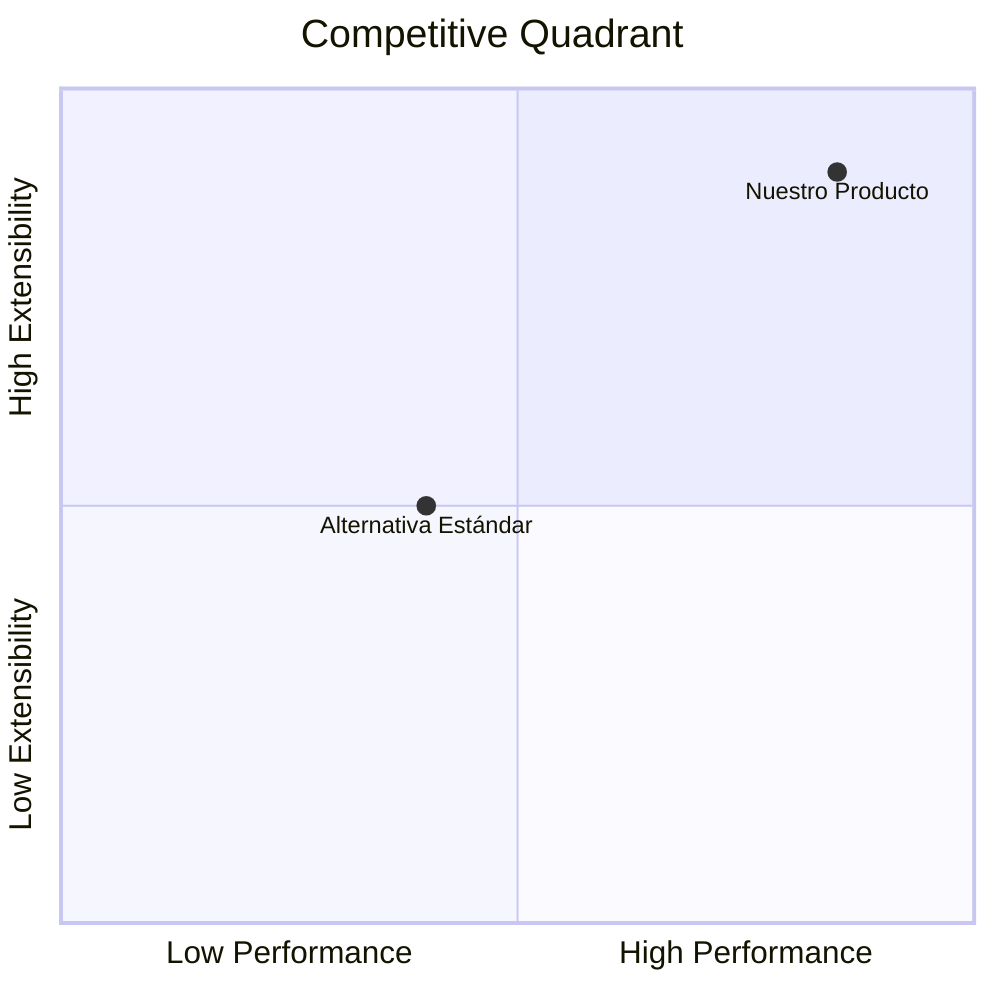

# Product Requirement Document (PRD)

## Product Goals
- [Meta 1: Propósito de negocio central]
- [Meta 2: Alcance y consumidores de la solución]

## User Stories & Acceptance Criteria
1. **Historia 1:** Como [rol de usuario], quiero [acción/funcionalidad] para [beneficio/valor].
   - **Criterio de Aceptación (Gherkin):**
     ```gherkin
     Escenario: [Título del escenario de éxito]
       Dado [precondición del sistema y autenticación]
       Cuando [acción o petición a la API]
       Entonces [resultado esperado y código HTTP]
     ```
2. **Historia 2:** Como [rol de usuario], quiero [manejo de errores robusto] para [no corromper datos].
   - **Criterio de Aceptación (Gherkin):**
     ```gherkin
     Escenario: [Rechazo de entrada inválida]
       Dado [payload con datos erróneos]
       Cuando [la API procesa la petición]
       Entonces [retorna código 422 y detalle RFC 7807]
     ```

## Competitive Analysis
1. "[Alternativa 1]: [Descripción de fortalezas y debilidades]."
2. "[Alternativa 2]: [Descripción de fortalezas y debilidades]."

### Competitive Quadrant Chart


## Technical Constraints & Discovery Agreements (Fase 0)
- **Estilo de Arquitectura:** [REST / FastAPI / CLI / etc.]
- **Seguridad & Auth:** [JWT / API-Key / Pública]
- **Persistencia:** [SQLite / Postgres / Memory]
- **Esquema de Errores:** [RFC 7807 Problem Details]

## Requirement Pool
- **P0 (Críticos):**
  - [Funcionalidad crítica 1]
  - [Funcionalidad crítica 2]
- **P1 (Secundarios):**
  - [Funcionalidad secundaria 1]

## Interface / API Contract Draft
- `[MÉTODO] /api/v1/[recurso]` - [Descripción]
- `[MÉTODO] /api/v1/[recurso]/{id}` - [Descripción]

## Anything UNCLEAR
All requirements, domain models and architectural constraints were clarified and frozen via Phase 0 Grilling (see `shared_pool/01_prd/DISCOVERY_NOTES.md`).