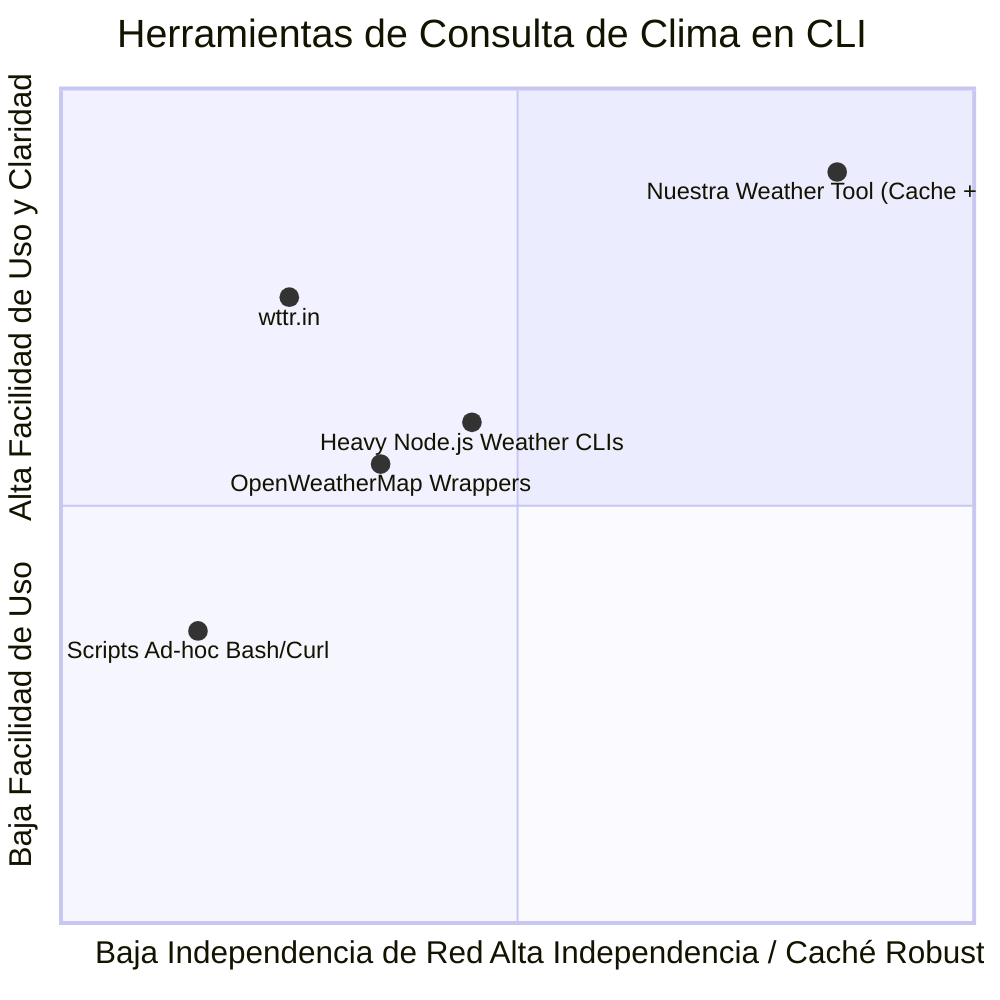

# Product Requirement Document (PRD)

## Product Goals
1. Proporcionar una herramienta CLI robusta, rápida y modular para consultar el pronóstico y estado del clima actual por ciudad.
2. Implementar un mecanismo de caché local con tiempo de expiración (TTL) configurable para minimizar llamadas a la red, reducir latencia y permitir consultas sin conexión si el dato es reciente.
3. Proveer una suite completa de pruebas unitarias que garanticen una alta cobertura, resiliencia ante errores de red, respuestas inválidas y manejo adecuado del caché.

## User Stories
1. **Consulta directa del clima:** Como usuario, quiero ingresar el nombre de una ciudad (ej. `weather-cli --city "Buenos Aires"`) para ver la temperatura actual, humedad, condición meteorológica y sensación térmica.
2. **Eficiencia mediante caché local:** Como usuario, quiero que consultas sucesivas a la misma ciudad dentro del período de validez (TTL) se resuelvan instantáneamente desde el almacenamiento local sin consumir cuota de red ni incurrir en demoras.
3. **Control y purga de caché:** Como usuario, quiero poder forzar una actualización (ej. `--refresh`) o vaciar el caché local (ej. `--clear-cache`) para garantizar que la información refleje los datos más recientes cuando sea necesario.
4. **Resiliencia ante fallos de red:** Como usuario, quiero recibir mensajes de error claros y amigables si la red está inaccesible o la ciudad no existe, sin que el sistema sufra caídas abruptas (crashes).
5. **Configuración de unidades:** Como usuario, quiero poder solicitar la temperatura en grados Celsius o Fahrenheit mediante un flag (ej. `--units metric|imperial`).

## Competitive Analysis
1. **wttr.in (curl/CLI tool):** Muy popular y sin API key, pero depende de conexión continua y carece de caché estructurado local persistente.
2. **Open-Meteo CLI integrations:** Excelente precisión, sin requerir API key para uso estándar no comercial, compatible con geocodificación abierta.
3. **OpenWeatherMap CLI wrappers:** Ampliamente adoptados, pero requieren registro forzoso y gestión de API keys por usuario.
4. **Weather-cli (Node.js/NPM):** Fácil de usar pero con dependencias pesadas en Node.js y dependiente de servicios comerciales de API.
5. **Weatherbug / AccuWeather CLI scripts:** Tienen limitaciones de rate limiting severas y formatos de respuesta heterogéneos.

### Competitive Quadrant Chart


## Requirement Analysis & Technical Constraints
- **Arquitectura agnóstica / Propuesta técnica:** Herramienta desarrollada preferentemente en Python 3 estándar o moderno con tipado estricto, utilizando librerías estándar o de bajo overhead (`urllib`/`requests`, `sqlite3`/`json`).
- **Mecanismo de Caché:** Almacenamiento local estructurado (SQLite o archivo JSON indexado en disco) con marca temporal (timestamp) y TTL por defecto (ej. 10 a 30 minutos).
- **Proveedor Meteorológico:** Proveedor de API pública y libre de barreras como Open-Meteo (Geocoding API + Weather Forecast API) o fallback estructurado, sin requerir claves privadas del usuario para pruebas iniciales, con capacidad de inyección/mocking en tests.
- **Manejo de Errores:** Control estricto de excepciones de red (timeouts, DNS, errores HTTP 404/500) y de formato JSON.

## Requirement Pool
```json
[
  {"id": "REQ-01", "name": "Consulta de Clima por Ciudad", "priority": "P0", "description": "Resolver geocodificación de la ciudad y consultar temperatura, condición y humedad."},
  {"id": "REQ-02", "name": "Caché Local Persistente con TTL", "priority": "P0", "description": "Guardar respuestas válidas localmente y servir datos en caché si no ha expirado el TTL."},
  {"id": "REQ-03", "name": "Suite de Tests Unitarios Automatizados", "priority": "P0", "description": "Cobertura de casos de éxito, fallo de red, expiración de caché y datos corruptos con mocks."},
  {"id": "REQ-04", "name": "Parámetros CLI y Banderas (--clear-cache, --ttl, --units)", "priority": "P1", "description": "Permitir control de opciones de ejecución desde la línea de comandos."},
  {"id": "REQ-05", "name": "Salida Estilizada / Formateada", "priority": "P1", "description": "Visualización limpia en terminal con opción de salida en texto o formato JSON."}
]
```

## UI / CLI / Interface Draft
Ejemplos de invocación por terminal:
```bash
# Consulta básica
weather-cli --city "Madrid"

# Salida esperada:
# Clima en Madrid (ES):
# - Temperatura: 18.5 °C
# - Condición: Despejado
# - Humedad: 55%
# - Viento: 12 km/h
# [Fuente: Red / API pública | Guardado en caché (TTL: 1800s)]

# Segunda consulta inmediata:
# [Fuente: Caché local | Válido por 1780s más]

# Opciones avanzadas:
weather-cli --city "Tokyo" --ttl 3600 --units imperial --json
weather-cli --clear-cache
```

## Anything UNCLEAR
There are no unclear points. Todos los requisitos funcionales, criterios de aceptación y restricciones operativas están claramente definidos para que el Arquitecto diseñe el sistema y especifique el stack técnico.
