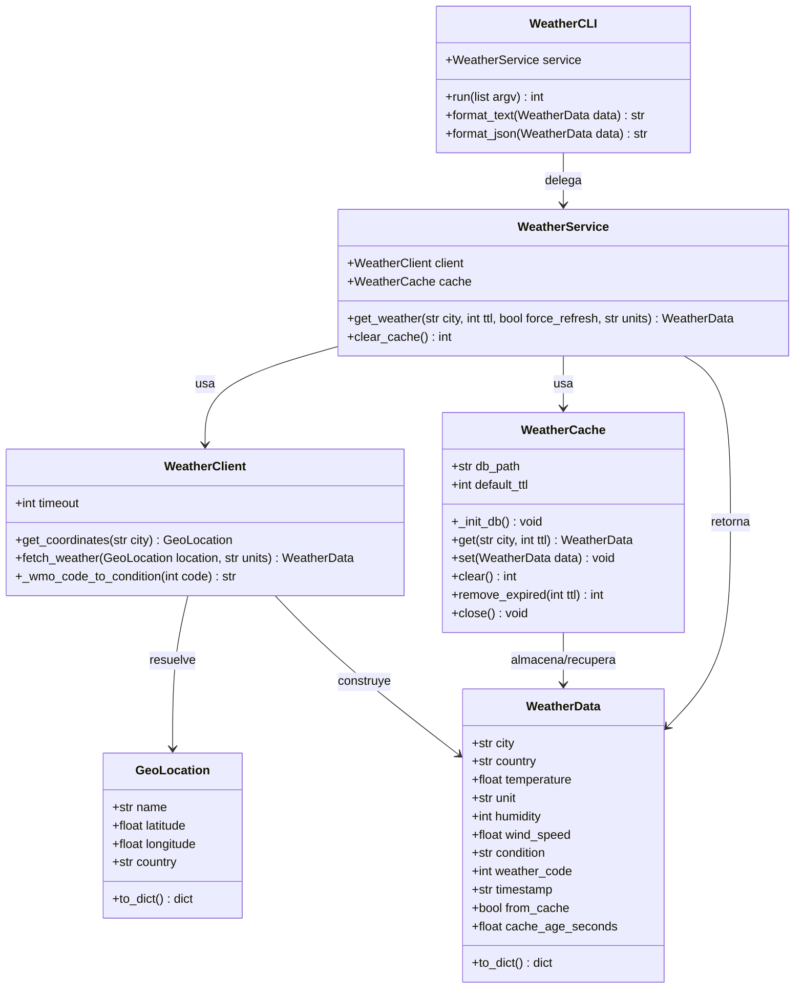
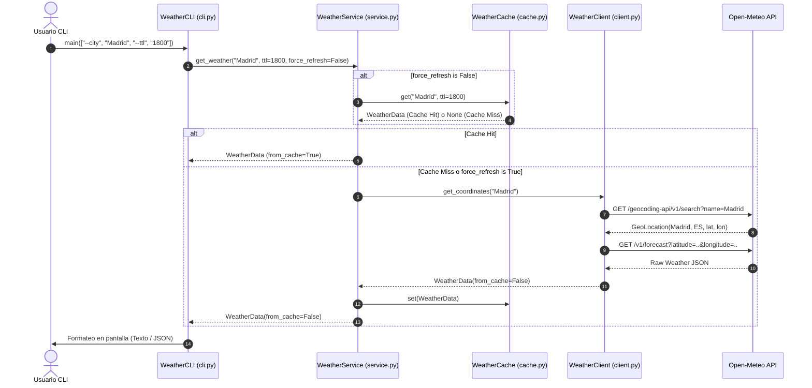

# System Design: Weather CLI with Local Cache

## Implementation Approach
Para satisfacer los requerimientos del PRD de forma modular, extensible y de cero dependencias externas conflictivas, se utilizará Python 3 estándar con una arquitectura en capas:
- **Capa de Dominio y Modelos (`models.py`):** Define `GeoLocation` y `WeatherData` con tipado estricto mediante `@dataclass`, serialización a diccionario/JSON y compatibilidad con diferentes unidades (Celsius, Fahrenheit).
- **Capa de Persistencia / Caché (`cache.py`):** `WeatherCache` encapsula almacenamiento en base de datos local SQLite (`weather_cache.db`), administrando timestamps en UTC, expiración por TTL (Time-To-Live), invalidación y purga manual.
- **Capa de Integración / Red (`client.py`):** `WeatherClient` consume APIs abiertas y gratuitas (Open-Meteo Geocoding API para resolver latitud/longitud y Open-Meteo Forecast API para obtener temperatura, humedad, viento y código meteorológico WMO). Incluye transporte desacoplado para inyección de mocks en tests sin requerir internet.
- **Capa de Servicio / Orquestación (`service.py`):** `WeatherService` coordina la lógica de negocio: consulta el caché; si existe y está vigente (cache hit), retorna los datos marcados con origen `CACHE`; si expiró o no existe o se forzó recarga (`--refresh`), consulta `WeatherClient`, actualiza el caché y retorna con origen `API`.
- **Capa de Presentación / CLI (`cli.py` & `main.py`):** Parser de argumentos con `argparse`, formateo legible en consola con indicadores de caché/TTL y soporte para salida JSON estructurada.

## Project / Package / Module Name
`weather_tool`

## Data Structures and Interface Definitions


## Program Call Flow


## File List
Lista cerrada y autorizada de archivos para la implementación del proyecto:
```python
[
    "environment/workspace/weather_tool/__init__.py",
    "environment/workspace/weather_tool/models.py",
    "environment/workspace/weather_tool/cache.py",
    "environment/workspace/weather_tool/client.py",
    "environment/workspace/weather_tool/service.py",
    "environment/workspace/weather_tool/cli.py",
    "environment/workspace/main.py",
    "environment/workspace/tests/__init__.py",
    "environment/workspace/tests/test_models.py",
    "environment/workspace/tests/test_cache.py",
    "environment/workspace/tests/test_client.py",
    "environment/workspace/tests/test_service.py",
    "environment/workspace/tests/test_cli.py"
]
```

## Anything UNCLEAR
There are no unclear points. El diseño proporciona una separación clara entre modelo, transporte, persistencia y CLI, listo para la fase de desglose de tareas y posterior codificación.
