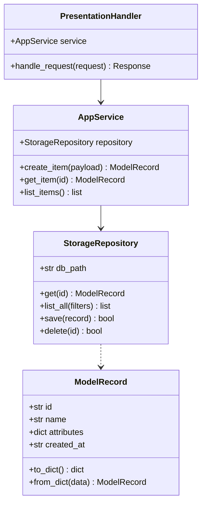
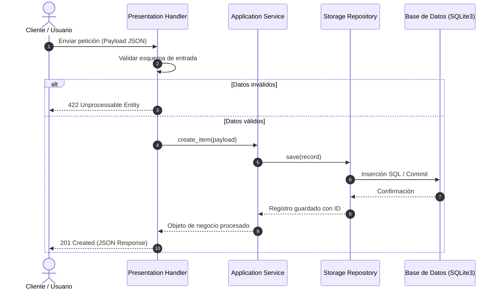

# System Design Specification: Sistema

## 1. Implementation Approach & Tech Stack
- **Patrón Arquitectónico:** Service-Repository Layered Pattern con separación estricta de responsabilidades.
- **Lenguaje Principal:** Python 3.11+
- **Persistencia:** SQLite3 con transaccionalidad ACID.
- **Testing:** unittest (Python Standard Library) para ejecución instantánea sin dependencias externas obligatorias.

---

## 2. Diagrama de Clases y Estructuras (Data Structures)

---

## 3. Diagrama de Flujo de Llamadas (Sequence Diagram)

---

## 4. File List (Superficie Autorizada de Archivos)
1. `environment/workspace/app/__init__.py`
2. `environment/workspace/app/models.py`
3. `environment/workspace/app/storage.py`
4. `environment/workspace/app/service.py`
5. `environment/workspace/app/api.py`
6. `environment/workspace/main.py`
7. `environment/workspace/tests/__init__.py`
8. `environment/workspace/tests/test_models.py`
9. `environment/workspace/tests/test_storage.py`
10. `environment/workspace/tests/test_service.py`

---

## 5. Anything UNCLEAR
The architectural boundaries, interfaces, and file boundaries are fully frozen and ready for code implementation.
