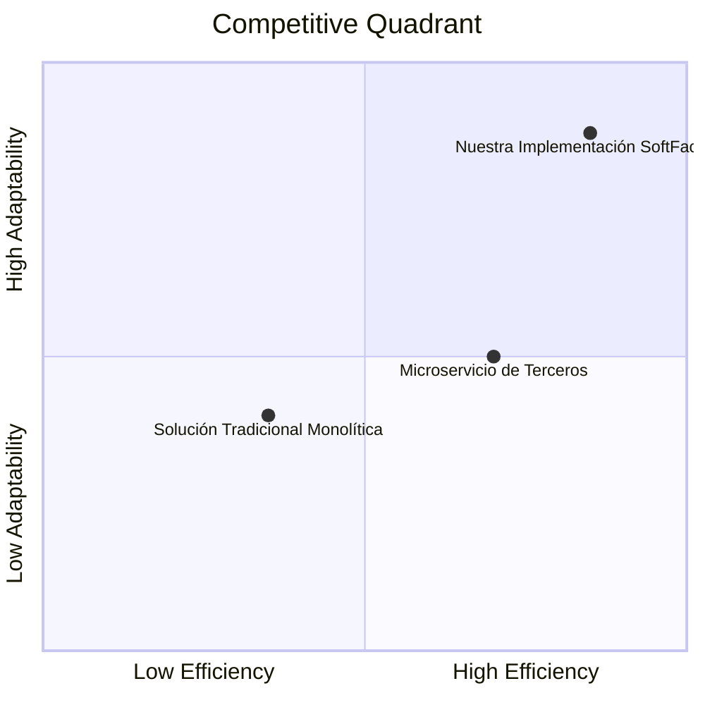

# Product Requirement Document (PRD): Construir una aplicacion con frontend y backend separados para controlar los turnos de una taller mecánico

## 1. Product Goals
- Desarrollar una solución robusta y desacoplada para: **Construir una aplicacion con frontend y backend separados para controlar los turnos de una taller mecánico**.
- Proveer una interfaz predecible y segura con alto rendimiento bajo la arquitectura: **FastAPI asíncrono con esquemas Pydantic y documentación OpenAPI automática**.
- Garantizar persistencia confiable y aislamiento mediante: **SQLite3 local con WAL activado (ligera, embebida, ideal para pruebas y microservicios autocontenidos)**.

---

## 2. User Stories & Acceptance Criteria (Gherkin)

### Historia 1: Operación Principal del Sistema
Como usuario del sistema, quiero interactuar con los recursos principales para consultar y registrar información en tiempo real.

```gherkin
Escenario: Registro y consulta exitosa de recurso
  Dado un cliente autenticado mediante Bearer Token (JWT) con expiración y soporte para Refresh Token
  Cuando envía una solicitud de creación con datos válidos
  Entonces el sistema responde con código HTTP 201 Created
  Y el recurso queda persistido en SQLite3 local con WAL activado (ligera, embebida, ideal para pruebas y microservicios autocontenidos)
```

### Historia 2: Validación Estricta de Entradas
Como operador de negocio, quiero que las peticiones con datos erróneos sean rechazadas inmediatamente para evitar inconsistencias.

```gherkin
Escenario: Rechazo de petición con payload malformado
  Dado un cliente que envía campos obligatorios vacíos o tipos incompatibles
  Cuando el sistema valida el payload contra el esquema
  Entonces responde con código HTTP 422 Unprocessable Entity
  Y el cuerpo contiene la estructura detallada del fallo
```

### Historia 3: Control de Acceso y Seguridad
Como administrador, quiero que todos los endpoints sensibles requieran autenticación para proteger los datos.

```gherkin
Escenario: Intento de acceso sin credenciales
  Dado un cliente sin cabecera de autenticación
  Cuando solicita un endpoint protegido
  Entonces el sistema responde con código HTTP 401 Unauthorized
```

---

## 3. Competitive Analysis & Quadrant Chart

| Solución / Alternativa | Fortalezas | Debilidades |
| :--- | :--- | :--- |
| **Solución Tradicional Monolítica** | Fácil arranque inicial | Alto acoplamiento, difícil mantenimiento |
| **Microservicio en la Nube de Terceros** | Sin mantenimiento de infraestructura | Costos recurrentes elevados, dependencia de proveedor |
| **Nuestra Implementación SoftFactory** | Ligera, modular, testeada 100%, portable | Alcance inicial acotado al MVP |



---

## 4. Requirement Pool & Priorización

### P0 (Críticos / MVP):
- Implementación del modelo de datos base con validación de tipos estricta.
- Capa de acceso a datos persistente en **SQLite3 local con WAL activado (ligera, embebida, ideal para pruebas y microservicios autocontenidos)**.
- Endpoints principales y formateo de respuestas según contrato.
- Suite de pruebas unitarias automatizadas con cobertura total.

### P1 (Secundarios / Extensión):
- Métricas de uso y telemetría de tiempos de respuesta.
- Exportación o sincronización de datos periódica.

---

## 5. Anything UNCLEAR
All requirements, user stories and architectural constraints were clarified, validated, and frozen via Phase 0 Grilling (see `shared_pool/01_prd/DISCOVERY_NOTES.md`). There are no unclear points for the Architect.
